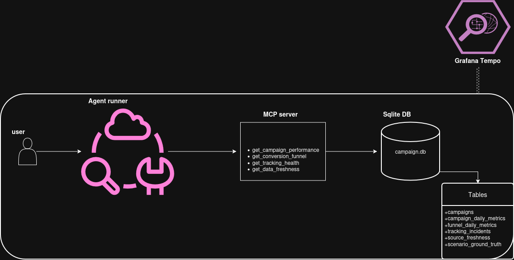

# Governed Marketing Data MCP

**This is a human-written README.**

`governed-marketing-data-mcp` is a proof-of-concept agentic application workflow for marketing analytics data.

This PoC demonstrates end-to-end observability using OpenTelemetry, with focus on all the tool calls (requests) the agent makes to the MCP server. It also includes an evaluator that checks the correctness of the final result from the agent which provides even more insight into how the agent arrived at an answer.

## Architecture and Components

With the MCP server being the core layer and a custom agent runner, it provides a gateway to data for a fictitious analytics team with controlled access. It also includes the option of selecting a preferred LLM using either local or cloud-based inference.




### Core Components

- **Agent Runner**: Initiates a request, a hard-coded prompt and executes it with configurable LLM providers (local or cloud).
- **MCP Server**: Manages tool definitions, handles agent requests, and enforces access control.
- **Sqlite database**: Holds campaign data and represents a data warehouse - access is via the MCP server.
- **Grafana Tempo & OpenTelemetry**: Captures end-to-end events via OpenTelemetry and sends the data to Grafana.
- **Evaluator**: Validates final results against expected outcomes for quality assurance.


## Quick Start

### 1. Configure the environment

Create a local `.env` from the example and set at least `DEMO_BEARER_TOKEN`:

```bash
cp .env.example .env
```

Generate a local MCP bearer token:

```bash
openssl rand -hex 32
```

Add it to `.env` which should contain all the following variables:


```dotenv
DEMO_BEARER_TOKEN=<generated-local-token>
OTEL_EXPORTER_OTLP_ENDPOINT=localhost:4317
MODEL_BASE_URL=https://api.openai.com/v1
MODEL_API_KEY=<your-api-key>
MODEL_NAME=gpt-4o-mini
```
For fake model provider, you can omit model variables.

Load the environment:

```bash
set -a
source .env
set +a
```

### 2. Start Tempo, the OTel Collector, and Grafana

```bash
docker compose up -d
```

### 3. Prepare and start the MCP server

```bash
make db-setup
OTEL_SERVICE_NAME=governed-marketing-data-mcp-server make run-server
```

Leave this terminal running.

### 4. Run the agent

In a second terminal:

```bash
set -a
source .env
set +a

OTEL_SERVICE_NAME=governed-marketing-data-mcp-agent-runner \
go run ./cmd/agent-runner \
  --provider openai_compatible \
  --output artifacts/runs/agent-openai-run.json
```

For a test without a model API call, omit `--provider openai_compatible`.


### 5. Open Tempo in Grafana

Open:

```text
  http://localhost:3000
```

Then go to:

```text
  Explore --> Tempo
```

Use this TraceQL query:

```text
  { .service.name = "governed-marketing-data-mcp-agent-runner" }
```

set the time range to **Last 15 minutes**, then click **Run query**.


## Further Documentation
See [docs](./docs/) for more detailed and granular documentation on each part of this PoC. However, those are AI generated.


## Coding Agent used to Build this PoC

- [PiAgent](https://pi.dev/) with ChatGPT Plus (Codex) subscription.